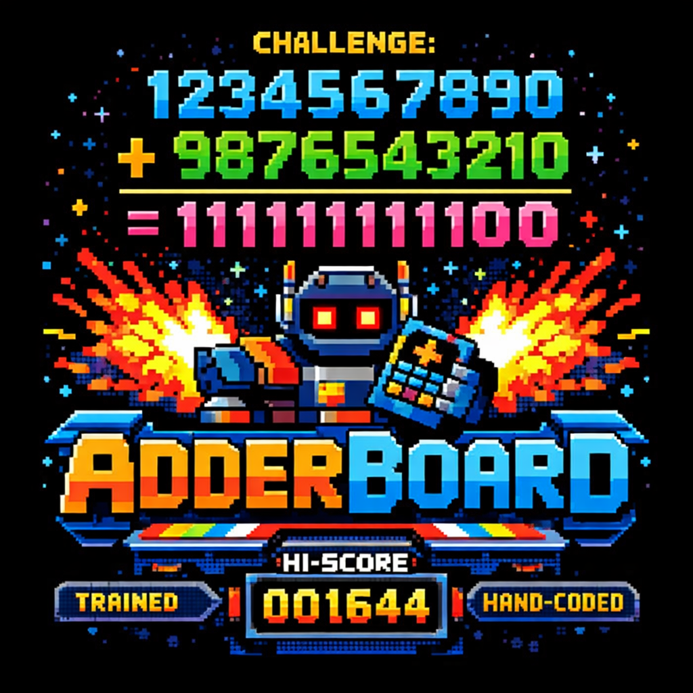

# AdderBoard

<p align="center">
  
</p>

**Challenge:** Build the smallest transformer that can add two 10-digit numbers with >= 99% accuracy on a held-out 10K test set.

This started with [Addition Under Pressure](https://dimitrisp.substack.com/p/addition-under-pressure), where I gave Claude Code and Codex the same prompt: train the smallest possible transformer that can do 10-digit addition with at least 99% accuracy. [Claude Code](https://github.com/anadim/smallest-addition-transformer-claude-code) came back with 6,080 parameters and [Codex](https://github.com/anadim/smallest-addition-transformer-codex) came back with 1,644. The community has since pushed this dramatically lower.

Maintained by [Dimitris Papailiopoulos](https://github.com/anadim) ([@dimitrispapail](https://x.com/dimitrispapail)).

We track two categories:

- **Trained** — weights learned from data by any training algorithm (SGD, Adam, evolutionary search, etc.). The algorithm must be generic — it should work with any model and dataset, not just this specific problem. This encourages creative ideas around data format, tokenization, curriculum learning, and architecture search.
- **Hand-coded** — weights set analytically. This is a constructive proof that the architecture *can* represent addition, regardless of whether SGD would find it.

Both are valid. Both are interesting.

## Leaderboard

### Hand-Coded Weights (Constructive Proofs)

| Rank | Params | Accuracy | Author | Built with | Architecture | Key Tricks | Link |
|------|--------|----------|--------|------------|-------------|------------|------|
| 1 | 5*** | 100% | [harishsg993010](https://github.com/harishsg993010) | EVO agent (Claude Sonnet 5.5) | 1L decoder, 2h, d=1 (scalar residual), sinusoidal PE period 11, no MLP/norm | Parametric scalar tied embedding + cos read-out (1 param), period-11 PE digit routing with two fixed phases, sigmoid carry hinge on fed-back output digit, shared attention temperature | [repo](https://github.com/harishsg993010/adderboard-5p) |
| 2 | 6* | 100% | [zcbtrak](https://github.com/zcbtrak) | | 1L Qwen-derived decoder, d=2, 1h, hd=2, ff=2 (fixed Q, folded norm) | RoPE period-19, hardcoded Q_proj (PE exemption), norm weights folded into tied output head, tied carry hinge gate, shared carry-scale scalar | [gist](https://gist.github.com/zcbtrak/b9af065d6395a3ecd72e3b8d2e867ae9) |
| 3 | 8 | 100% | [kswain98](https://github.com/kswain98) | | 1L Qwen-style decoder, d=2, 1h, hd=2, ff=2 | RoPE period-19, phase-tied Q projection (1 param), coupled quadratic embedding (1 param), tied carry hinge gate, shared carry-scale scalar | [repo](https://github.com/kswain98/AdderBoard) |
| 4 | 10 | 100% | [lokimorty](https://github.com/Lokimorty) | | 1L Qwen-derived decoder, d=2, 1h, hd=2, ff=2 | RoPE period-19, parametric tied embedding, gate tying via algebraic identity, merged carry scalar | [gist](https://gist.github.com/Lokimorty/d54e5c61997e00fb922b6692739a0f6c) |
| 5 | 12 | 100% | [lokimorty](https://github.com/Lokimorty) | | 1L Qwen-derived decoder, d=2, 1h, hd=2, ff=2 | RoPE period-19, parametric tied embedding, sparse attention/MLP, constructive carry hinge | [gist](https://gist.github.com/Lokimorty/cf27201cf6326b04c7328b6abe62248e) |
| 6 | 20 | 100% | [yieldthought](https://github.com/yieldthought) | | 1L decoder, d=2, 1h, hd=2 | Quadratic tied embedding + tied output head, RoPE-19 digit routing, sparse tied V/O, two-hinge ReLU MLP, parameterless pre-norm | [gist](https://gist.github.com/yieldthought/a48b8d690d31039fadddd2bf297cae99) |
| 7 | 27 | 100% | [Wonderfall](https://github.com/Wonderfall) ([@w0nderfall](https://x.com/w0nderfall)) | | 1L decoder, d=2, 1h, hd=2 | Tied Q/K + V/O, cross-tied W_vo as MLP w2, factorized quadratic embedding, compressed MLP w1, RoPE period-19 | [gist](https://gist.github.com/Wonderfall/bd1a2396eb9f846637f469d90823b48d) |
| 8 | 28 | 100% | [jacobli99](https://github.com/SeuperHakkerJa) | | 1L decoder, d=2, 5h (MQA), hd=2, ff=4 | Tied parabolic decode, RoPE digit routing, sparse O-proj, tied MLP, matrix broadcast | [gist](https://gist.github.com/SeuperHakkerJa/da3050739bea97aabd86ee0d7d5ef689) |
| 9 | 31 | 100% | [Arch222](https://github.com/Arch222) | | 1L decoder, d=3, 4h/1kv, hd=2, ff=4 | RoPE offset-targeted queries, sparse O-proj, SwiGLU carry detection, tied embed decode | [repo](https://github.com/Arch222/Addition_Final) |
| 10 | 33 | 100% | [fblissjr](https://github.com/fblissjr) | Claude Code + Gemini | 1L decoder, d=3, 3h (d_head=1), ff=4 | ALiBi prefix sum for carry, e^80 softmax anchoring, residual cancellation head, 2-hinge ReLU step, parabolic LM head, float64 | [repo](https://github.com/fblissjr/AdderBoard/blob/main/submission_1l.py) |
| 11 | 36 | 100% | [alexlitz](https://github.com/alexlitz) | | 2L decoder, d=5, 5h+1h | ALiBi slope=log(10) for base-10 weighting, sparse embed, gated ReLU FFN, float64 | [gist](https://gist.github.com/alexlitz/0d5efbccf443fb0e8136b8f5bd85140a) |
| 12 | 50 | 100% | [lichengliu03](https://github.com/lichengliu03) | | 1L custom GPT, d=4, 2h, hd=2 | Factorized embed, rotation Q (2 angles), tied embed+V dir, rank-1 MLP, parabolic head, sinusoidal PE (period 11) | [repo](https://github.com/lichengliu03/TinyAdder-50p) |
| 13 | 66 | 100% | [cosminscn](https://github.com/cosminscn) | | 1L nanoGPT, d=4, 2h | Rotation Q (2 angles), sparse c_proj (2 nonzero), parabolic lm_head, factorized embed, sinusoidal PE (period 11) | [gist](https://gist.github.com/cosminscn/e4d028281378e16b18e61fca1163f9cb) |
| 14 | 87 | 100% | [bingbangboom-lab](https://github.com/bingbangboom-lab) | | 2L Qwen3, d=5, 2h/1kv, hd=2, ff=3 | Cross-layer sharing, rank-1 projections, sparse gate, low-rank head, frozen scaling params | [gist](https://gist.github.com/bingbangboom-lab/ec367a6078e9ac2c5748dbbb78eae2a1) |
| 15 | 93 | 100% | [jacobli99](https://github.com/SeuperHakkerJa) | | 1L decoder, d=2, 5h (MQA), hd=2, ff=4 | Tied parabolic decode, RoPE digit routing, ReLU carry detection | [gist](https://gist.github.com/SeuperHakkerJa/9d615964d2284a9a699b5a24cf19e69d) |
| 16 | 111 | 100% | [corbensorenson](https://github.com/corbensorenson) | Codex | 1L decoder, d=3, 4h/1kv, hd=2, ff=2 | Tied embed, RoPE, SwiGLU, GQA | [repo](https://github.com/corbensorenson/adderboard-submissions) |
| 17 | 116 | 100% | [nino](https://github.com/prasannakotyal) | | 1L Qwen3, d=3, 4h/1kv, hd=2 | Tied embed, shared RMSNorm vectors, RoPE (hd=2) | [gist](https://gist.github.com/prasannakotyal/467d4c54564beba34d9d7edbd41c33dc) |
| 18 | 121 | 100% | [Wonderfall](https://github.com/Wonderfall) ([@w0nderfall](https://x.com/w0nderfall)) | Codex | 1L Qwen3, d=3, 4h/1kv, hd=2, ff=2 | Tied embed, RoPE digit routing, carry via final norm, SiLU wrap detection | [gist](https://gist.github.com/Wonderfall/7d6f49aa6703352f94d3d80b4cd31e15) |
| 19 | 130 | 100% | [cosminscn](https://github.com/cosminscn) | | 1L nanoGPT, d=4, 2h | Rank-1 linear, factorized embed, sinusoidal PE (period 11), ReLU carry detection, parabolic logit decoding | [gist](https://gist.github.com/cosminscn/89c110dbae76ea0c873d67607e466f5b) |
| 20 | 130 | 100% | [Wonderfall](https://github.com/Wonderfall) ([@w0nderfall](https://x.com/w0nderfall)) | Codex | 1L Qwen3, d=3, 4h/1kv, hd=2, ff=3 | Tied embed, RoPE digit routing, SiLU carry logic | [gist](https://gist.github.com/Wonderfall/066df10de455cdc090900944bdc646cd) |
| 21 | 139 | 100% | [Wonderfall](https://github.com/Wonderfall) ([@w0nderfall](https://x.com/w0nderfall)) | GPT-5.2 Pro + Codex | 1L Qwen3, d=3, 4h/1kv, hd=2 | Tied embed, RoPE digit routing, SiLU carry logic | [gist](https://gist.github.com/Wonderfall/191bea43ff7f9316ac178b6c185d7165) |
| 22 | 148 | 100% | [bingbangboom-lab](https://github.com/bingbangboom-lab) | | 2L Qwen3, d=5, 2h/1kv, hd=2, ff=3 | Rank-1 linear, factorized embed, sparse gate, param-free norm, low-rank head, cross-layer sharing | [gist](https://gist.github.com/bingbangboom-lab/3594f00a1aa0b668e70a92c396d0f0d1) |
| 23 | 177 | 100% | [xangma](https://github.com/xangma) ([@xangma](https://x.com/xangma)) | GPT + Codex | 2L Qwen3, d=5, 2h/1kv, hd=2 | Rank-1 linear, factorized embed, sparse gate, param-free norm, low-rank head | [gist](https://gist.github.com/xangma/1c2a1b2f9ca871b1f15646eed60d10ab) |
| 24 | 197 | ~100%** | [xangma](https://github.com/xangma) ([@xangma](https://x.com/xangma)) | GPT + Codex | 2L Qwen3, d=5, 2h/1kv, hd=2 | Rank-1 linear, factorized embed, sparse gate, param-free norm | [gist](https://gist.github.com/xangma/c538a7a9d415f16e61f7bb26ae5cf6b0) |

\* *Parameter count debated: the 6 counted parameters sit within an architecture that has 4 additional hardcoded weight values (Q projection and RMSNorm weights) that were counted as parameters in the parent 10p submission. Under strict counting this model has 10 unique weight values; under the submitter's accounting, 6. See [#75](https://github.com/anadim/AdderBoard/issues/75) for discussion. We may be approaching the practical minimum for this architecture family.*

\*\* *Passed 8,192 random tests; not independently verified on our 10K test suite yet.*

\*\*\* *Submitted for review: 5 counted `nn.Parameter`s (embedding scale tied to the read-out, attention temperature, carry-gate sharpness and threshold, head gain). The digit embedding is parametric (`omega * token`) rather than a table, and the two attention phases (offset 0 and +1) live in the fixed period-11 sinusoidal PE buffer, which the counting convention treats as free; a reviewer who counts a hard-coded phase offset as a weight would read this as 6–7. No numeric constants act as weights inside `forward()`. Verified 10,010/10,010 on seeds 2025, 4242 and 7 with `verify.py`.*

### Trained Weights (Learned from Data)

| Rank | Params | Accuracy | Author | Built with | Architecture | Key Tricks | Link |
|------|--------|----------|--------|------------|-------------|------------|------|
| 1 | 36 | 100% | [tbukic](https://github.com/tbukic) | SuperchargeAI + Claude Code | 1L Qwen3, d=3, 1h/1kv, hd=4, ff=2, RoPE θ=3, SwiGLU | Circular arc embedding (3 params), K=rotation(Q), V=Q, tied O=Q^T, all RMSNorms shared, tied QK norms, down=rotation(up^T) | [repo](https://github.com/tbukic/M10S-Transformer/blob/main/submissions/submission_36p.py) |
| 2 | 39 | 99.91% | [lokimorty](https://github.com/Lokimorty) | | 1L Qwen3, d=3, 1h/1kv, hd=4, ff=2, RoPE θ=3, SwiGLU | Circular arc embedding, tied K=V, tied Q/O readout, shared RMSNorms, shared anti-quarter QK norm, repeat-mix shared block | [gist](https://gist.github.com/Lokimorty/b769726e4fd32ff2c5e08c7932a15f40) |
| 3 | 41 | 100% | [tbukic](https://github.com/tbukic) | SuperchargeAI + Claude Code | 1L Qwen3, d=3, 1h/1kv, hd=4, ff=2, RoPE θ=3, SwiGLU | Circular arc embedding (3 params), K=rotation(Q), V=Q, tied O=Q^T, all RMSNorms shared, tied QK norms | [repo](https://github.com/tbukic/M10S-Transformer/blob/main/submissions/submission_41p.py) |
| 4 | 44 | 100% | [tbukic](https://github.com/tbukic) | SuperchargeAI + Claude Code | 1L Qwen3, d=3, 1h/1kv, hd=4, ff=2, RoPE θ=3, SwiGLU | Circular arc embedding (3 params), K=Q, V=Q, tied O=Q^T, all RMSNorms shared, pure grokking (no targeted FT) | [repo](https://github.com/tbukic/M10S-Transformer/blob/main/submissions/submission_44p.py) |
| 5 | 45 | 100% | [tbukic](https://github.com/tbukic) | SuperchargeAI + Claude Code | 1L Qwen3, d=3, 1h/1kv, hd=4, ff=2, RoPE θ=3, SwiGLU | Circular arc embedding (3 params), K=rotation(Q), V=Q, tied O=Q^T, all RMSNorms shared | [repo](https://github.com/tbukic/M10S-Transformer/blob/main/submissions/submission_45p.py) |
| 6 | 52 | 100% | [Enara Vijil](https://github.com/vijec) | | 1L Qwen3, d=3, 1h/1kv, hd=4, ff=2, RoPE θ=3, SwiGLU | Circular arc embedding, tied K=V, tied O=Q^T, all RMSNorms shared, shared QK norms, Grokfast-EMA | [repo](https://github.com/vijec/AdderBoard-Submission/blob/main/submission-52/submission_52p.py) |
| 7 | 55 | 100% | [tbukic](https://github.com/tbukic) | SuperchargeAI + Claude Code | 1L Qwen3, d=3, 1h/1kv, hd=4, ff=2, RoPE θ=3, SwiGLU | Circular arc embedding (3 params), K=αQ, gate=α·up, tied O=Q^T, shared block RMSNorms | [repo](https://github.com/tbukic/M10S-Transformer/blob/main/submissions/submission_55p.py) |
| 8 | 57 | 100% | [evindor](https://github.com/evindor) | Claude Code + Codex | 1L decoder, d=5(2+3), 1h, qk=4, hd=5, ff=2 | Parametric circular embed, tied V/O, tied Q/K+phase, tied fc2=head_proj, rank-1 out, shared norm | [repo](https://github.com/evindor/MicroAdder/tree/main/submission_57p) |
| 9 | 58 | 100% | [tbukic](https://github.com/tbukic) | SuperchargeAI + Claude Code | 1L Qwen3, d=3, 1h/1kv, hd=4, ff=2, RoPE θ=3, SwiGLU | Circular arc embedding (3 params), K=αQ, gate=α·up, tied O=Q^T | [repo](https://github.com/tbukic/M10S-Transformer/blob/main/submissions/submission_58p.py) |
| 10 | 62 | 100% | [tbukic](https://github.com/tbukic) | SuperchargeAI + Claude Code | 1L Qwen3, d=3, 1h/1kv, hd=4, ff=2, RoPE θ=3, SwiGLU | Circular arc embedding (3 params), tied K=V, tied O=Q^T, tied lm_head, Adam no weight decay | [repo](https://github.com/tbukic/M10S-Transformer/blob/main/submissions/submission_62p.py) |
| 11 | 67 | 100% | [evindor](https://github.com/evindor) | Claude Code + Codex | 1L decoder, d=5(2+3), 1h, qk=4, hd=5, ff=2 | Parametric circular embed (3p), tied V/O, tied Q/K+phase, rank-1 out, shared norm, carry-mix curriculum | [repo](https://github.com/evindor/MicroAdder/tree/main/submission_67p) |
| 12 | 83 | 100% | [tbukic](https://github.com/tbukic) | SuperchargeAI + Claude Code | 1L Qwen3, d=3, 1h/1kv, hd=4, ff=2, RoPE θ=3, SwiGLU | Tied embed, tied K=V, tied O=Q^T, shared all RMSNorms, iterated targeted fine-tuning | [repo](https://github.com/tbukic/M10S-Transformer/blob/main/submissions/submission_83p.py) |
| 13 | 86 | 100% | [tbukic](https://github.com/tbukic) | SuperchargeAI + Claude Code | 1L Qwen3, d=3, 1h/1kv, hd=4, ff=2, RoPE θ=3, SwiGLU | Tied embed, tied K=V, tied O=Q^T, shared block RMSNorms, L-BFGS + targeted fine-tuning | [repo](https://github.com/tbukic/M10S-Transformer/blob/main/submissions/submission_86p.py) |
| 14 | 89 | 100% | [tbukic](https://github.com/tbukic) | SuperchargeAI + Claude Code | 1L Qwen3, d=3, 1h/1kv, hd=4, ff=2, RoPE θ=3, SwiGLU | Tied embed, tied K=V, tied O=Q^T, RoPE (zero params), QK norms, 4-stage grokking-aware training | [repo](https://github.com/tbukic/M10S-Transformer/blob/main/submissions/submission_89p.py) |
| 15 | 95 | 99.03% | [tbukic](https://github.com/tbukic) | SuperchargeAI + Claude Code | 1L Qwen3 + circular arc embed, d=3, 1h/1kv, hd=4, ff=3, RoPE θ=3, SwiGLU | Circular arc embedding (3 params), tied lm_head to dynamic embed, RoPE, QK norms | [repo](https://github.com/tbukic/M10S-Transformer/blob/main/submissions/submission_95p.py) |
| 16 | 101 | 100% | [tbukic](https://github.com/tbukic) | SuperchargeAI + Claude Code | 1L Qwen3, d=3, 1h/1kv, hd=4, ff=2, RoPE θ=3, SwiGLU | Tied embed, tied O=Q^T, RoPE (zero params), QK norms, cosine LR + targeted fine-tuning | [repo](https://github.com/tbukic/M10S-Transformer/blob/main/submissions/submission_101p.py) |
| 17 | 122 | 99.95% | [staghado](https://github.com/staghado) | | 1L Qwen3, d=3, 1h/1kv, hd=4, ff=3 | Tied embed, RoPE θ=3 | [repo](https://github.com/staghado/minimal-ten-digit-addition-transformer) |
| 18 | 140 | 100% | [dimopep](https://github.com/dimopep) | Claude Code | 1L decoder, d=4, 1h/1kv, hd=4, ff=4, RoPE θ=3, SwiGLU | Tied K=V, tied O=Q^T, tied lm_head, QK-norm | [gist](https://gist.github.com/dimopep/27158a2b0ed983e32ee8f39af6e5a134) |
| 19 | 234 | 99.91% | [JackCai1206](https://github.com/JackCai1206) | Claude Code | 1L decoder, d=6 (3 tok + 3 pos), 2h, hd=3, ff=2 | Parametric spiral PE (4 params), split-head attn (QK-pos/V-tok), shared XYZ pos, tied output head, LSB-first | [repo](https://github.com/JackCai1206/smallest-addition-transformer) |
| 20 | 262 | 99.95% | [lichengliu03](https://github.com/lichengliu03) | | 1L decoder, d=4, 1h, ff=8 | Rank-3 factorization, shared-A tied-KV, RMSNorm, tied embed, curriculum learning | [repo](https://github.com/lichengliu03/TinyAdder-262p) |
| 21 | 275 | 99.98% | [ryanyord](https://github.com/ryanyord) | Gemini | 1L decoder, d=4, 1h, ff=8, ranks=(3,3,2,2) | SVD truncation of 311p, tied embed, low-rank factorization, shareA_tieKV, RMSNorm | [repo](https://github.com/ryanyord/tiny-adder-275p) |
| 22 | 305 | 99.98% | [h3nock](https://github.com/h3nock) | | 1L decoder, d=4, 1h, ff=9 | Low-rank factorization, shared-A tied-KV, RMSNorm, tied embed, learned PE, curriculum learning | [repo](https://github.com/h3nock/tiny-adder-lab/tree/exp/pe-sub512-search) |
| 23 | 311 | 99.999% | [rezabyt](https://github.com/rezabyt) ([@reza_byt](https://x.com/reza_byt)) | | 1L decoder, d=4, 1h, ff=8 | Rank-3 factorization, shared-A tied-KV, RMSNorm, grokking | [repo](https://github.com/rezabyt/digit-addition-311p) |
| 24 | 456 | 100% | [yinglunz](https://github.com/yinglunz) | | 1L decoder, d=7, 1h, ff=14 | Rank-3 factorization, shared-A tied-KV, rank-2 attn out, tied embed | [repo](https://github.com/yinglunz/A-456-Parameter-Transformer-Solves-10-Digit-Addition) |
| 25 | 491 | 99.97% | [rezabyt](https://github.com/rezabyt) ([@reza_byt](https://x.com/reza_byt)) | | 1L decoder, d=7 | Rank-3 factorization, RMSNorm, curriculum learning | [repo](https://github.com/rezabyt/digit-addition-491p) |
| 26 | 512 | 99.988% | [yinglunz](https://github.com/yinglunz) ([@yinglun122](https://x.com/yinglun122)) | | 1L decoder, d=7, 1h, ff=14 | Rank-3 factorization | [repo](https://github.com/yinglunz/A-456-Parameter-Transformer-Solves-10-Digit-Addition) |
| 27 | 777 | 99.69% | [Yeb Havinga](https://github.com/yhavinga) ([@YebHavinga](https://x.com/YebHavinga)) | Claude Code | 1L decoder, d=7, 1h, ff=14 | Tied embeddings, no FFN bias, curriculum learning | [repo](https://github.com/yhavinga/gpt-acc-jax) |
| 28 | 1,644 | 99.04% | [anadim](https://github.com/anadim) ([@dimitrispapail](https://x.com/dimitrispapail)) | Codex | 1L decoder, pair tokens | Pair token encoding (digit pairs as single tokens) | [repo](https://github.com/anadim/smallest-addition-transformer-codex) |
| 29 | 6,080 | 100% | [anadim](https://github.com/anadim) ([@dimitrispapail](https://x.com/dimitrispapail)) | Claude Code | 2L decoder, d=16, ff=48 | Systematic scaling, found phase transition at d=16 | [repo](https://github.com/anadim/smallest-addition-transformer-claude-code) |

## Rules

### The Core Constraint: Autoregressive Transformer

The model must operate as a **genuine autoregressive transformer**. This means:

1. **Self-attention is required.** The model must contain at least one self-attention layer. This is the defining feature of a transformer — without it, you have an MLP or RNN, not a transformer.

2. **The model must be autoregressive.** It receives a token sequence as input and predicts the next token. Output digits are generated one at a time, with each new token fed back as input for predicting the next. The carry propagation must emerge from this autoregressive process — not from explicit state variables passed between steps in Python.

3. **Standard forward pass.** The model's `forward()` method must be a standard tensor-in, logits-out computation. No problem-specific control flow (for-loops over digits, explicit carry variables, string manipulation) inside `forward()`. The autoregressive generation loop lives *outside* the model, exactly as it would for any language model.

4. **The model does the work, not the code.** The inference code should be generic autoregressive decoding that would work with *any* transformer checkpoint. If your generation loop contains addition-specific logic — manually pairing digits, threading carry state, indexing into specific positions — then the Python code is solving the problem, not the model.

In short: if you can swap in a different set of weights and use the exact same inference code for a different task, your setup is legitimate. If the inference code is inseparable from the algorithm, it's not.

### What's Allowed
- Architectural variations: rank-1/low-rank projections, factorized embeddings, custom positional encodings, alternative norms
- Hand-coded weights (constructive proofs are valid — they show the architecture *can* represent addition)
- Trained weights via any generic learning algorithm (shows the solution is *learnable* — encourages creative ideas on data format, tokenization, and curriculum)
- Input formatting choices (reversed digits, delimiters, etc.) as long as the format is fixed and doesn't encode the answer

### Qualification
- Must achieve **>= 99% accuracy** on 10,000 random test pairs (held-out, fixed seed)
- Inputs: two integers in [0, 9,999,999,999]
- Output: their sum as an integer
- Verified using `verify.py` with `--seed 2025`

### Parameter Counting
- Count **unique** parameters (after weight tying/deduplication)
- Fixed/sinusoidal positional encodings are not counted (following the original Transformer paper convention)
- Learned positional encodings are counted

## How to Submit

**Option A: Open an Issue (easiest)**
1. Click [New Issue](../../issues/new?template=new-submission.yml) and fill in the template
2. Include a link to your code (GitHub repo, gist, etc.)
3. Include test results (accuracy on random pairs)
4. We'll verify and add you to the leaderboard

**Option B: Open a Pull Request**
1. Fork this repo
2. Update the leaderboard in README.md with your entry
3. Include verification results
4. We'll review and merge

Updates to the leaderboard are welcome via pull request.

## Verification

```bash
python verify.py submissions/your_submission.py
```

This runs:
- 10 edge cases (boundary values, max carry chains)
- 10,000 random pairs (seed=2025)
- Reports accuracy, pass/fail, and timing

## Context

This challenge explores a fundamental question: **what is the minimal transformer that can represent integer addition?**

Addition requires three capabilities:
1. **Digit alignment** — pairing corresponding digits from two numbers
2. **Per-digit arithmetic** — computing sum and carry for each pair
3. **Carry propagation** — threading carry information across positions

Transformers solve these using attention (for alignment), MLPs (for arithmetic), and autoregressive generation (for carry propagation). The question is how small the architecture can be while still implementing all three.

### Key Findings from the Community
- **Parameter cliff at ~800**: Sharp accuracy transition observed by multiple researchers
- **Single layers beat two layers** at equivalent parameter budgets (for trained models)
- **d=7 was the sweet spot** for early trained models — multiple independent teams converged on this
- **d=4 now works** with rank-3 factorization + grokking (311 params trained)
- **d=3 is the new frontier** for trained models — circular arc embeddings + aggressive weight tying push to 36 params
- **Hand-coded models can go much smaller** (6* vs 36 trained) since they don't need to be discoverable by SGD
- **Rank-3 factorization** is the key trick for trained models at d>=4
- **Circular arc embedding + weight tying** is the key trick for trained models at d=3
- **ALiBi enables extreme compression**: the 36-param hand-coded leader uses ALiBi with slope log(10) for base-10 positional weighting, achieving 100% accuracy with a 2-layer decoder (d=5) in float64

## Citation

If you use AdderBoard in your research, please cite:

```bibtex
@misc{papailiopoulos2026adderboard,
  author       = {Papailiopoulos, Dimitris},
  title        = {{AdderBoard}: A Community Challenge for Tiny Arithmetic Transformers},
  year         = {2026},
  publisher    = {GitHub},
  howpublished = {\url{https://github.com/anadim/AdderBoard}},
  note         = {Open challenge and leaderboard for building the smallest transformers that can perform integer addition}
}
```

## License

MIT
